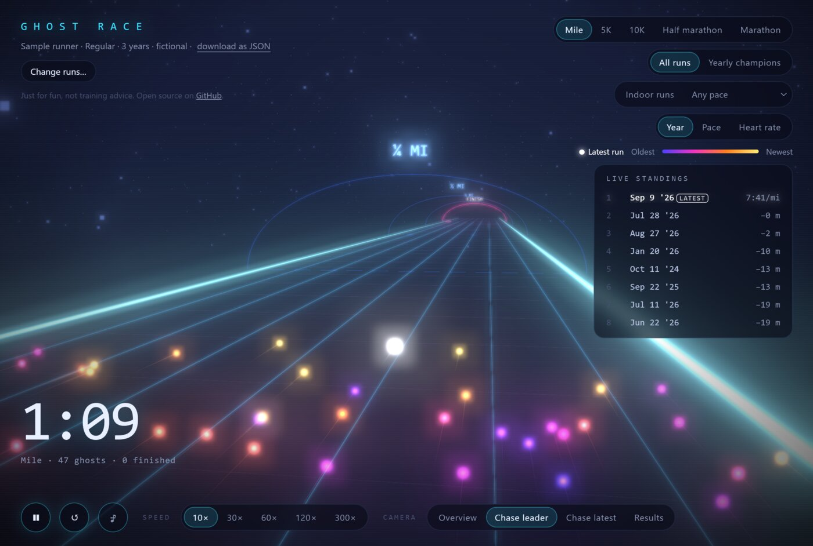

# Ghost Race

Every run you've done, racing each other as glowing ghosts on a neon road.



## Using it

Download `ghost-race.html` (on GitHub: open the file, then **Download raw file**) and open it in
your browser. There is nothing to install, and it works offline.

Then try a sample runner, or load your own runs file. Runs of a similar distance race that
distance at their average pace: Mile, 5K, 10K, half marathon and marathon. **Save as HTML** makes
a copy of the page with your runs inside it, to share with people you choose.

## Runs file

```json
{
  "title": "My runs",
  "runs": [
    { "date": "2024-05-31", "distance_m": 5120, "time_s": 1490, "hr": 151, "climb_m": 34, "indoor": false },
    { "date": "2024-06-02", "distance_m": 1650, "time_s": 432 }
  ]
}
```

`date`, `distance_m` (metres) and `time_s` (moving time in seconds) are required; `hr`,
`climb_m` and `indoor` are optional. See `examples/example-runs.json`. Use your own data, exported
from your own accounts.

## Building from source

With Node.js 20 or later:

```sh
cd build
npm ci          # three.js and esbuild, pinned exact versions
npm run build   # writes ../ghost-race.html from src/
npm test
```

## Privacy

The page makes no network requests and stores nothing. Runs you load stay in that browser tab. A
**Save as HTML** copy contains the runs you loaded.

## Disclaimers

- A personal project shared as is. There is no support, and issues and pull requests are not
  monitored.
- For fun only. It is not health, medical, fitness or training advice, and times are estimates
  that may be wrong.
- Not affiliated with or endorsed by any fitness service, app or device maker.
- You are responsible for the data you load and anything you share.

## Licence

MIT, Copyright (c) 2026 lawrips, without warranty or liability. See `LICENSE`. Bundled three.js
(MIT): see `THIRD_PARTY_NOTICES.md`.
